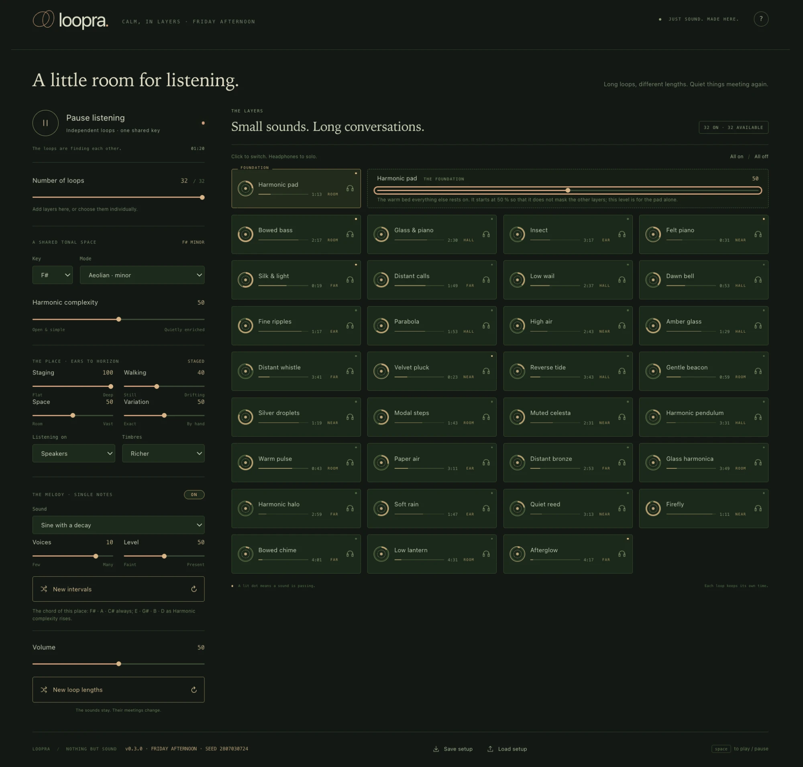

# Loopra — calm, in layers

**A small ambient instrument for your browser. Choose among 32 sound layers, each repeating at its own length, in one shared key and mode.**

**[⬇️ Download the latest release →](https://github.com/Quick-Eyed-Sky/loopra/releases/latest)** · [First opening on a Mac →](docs/first-opening.md)

Pads and bowed bass make a soft foundation. Glass, felt piano, little ripples, distant calls and long chords find their way through it. Leave a few layers together, or listen to one on its own.



*Sixteen layers are enabled at first. Every sound is synthesized in the browser.*

## New in 0.3.0 — Friday Afternoon

A nod to Brian Eno's *Thursday Afternoon*, which is made of single notes, each repeating at its own irregular interval, so that melodies are never written: they happen when the notes meet. Loopra now has **a melody machine** in the same spirit, and the first thing it does differently is keep every note in harmony with the place.

- **Single notes, each on its own interval.** From 2 to 12 voices. Each voice keeps one note of the chord of the place and plays it again after a time drawn at random between its own shortest and longest interval, so most voices are almost regular and a few wander. Every voice stands at its own distance, from near to far, like the layers. *New intervals* draws them again.
- **The notes follow the tonal space and the Harmonic complexity.** The machine plays the chord of the place, with the same ranks as the harmonic pad: root, third and fifth always; then the seventh, ninth, eleventh and thirteenth as the Harmonic complexity rises. Moving the slider never moves a note in time; it only decides which colours sound.
- **Nothing rubs.** Before it plays, each note is checked against the long notes of the layers and against the machine's own notes: no semitone, major seventh, minor ninth or tritone. A note that would rub is replaced by a neighbouring note of the chord, or left out.
- **Sound.** *Sine with a decay* (the default, as in Eno's piece): attack at once, 2.11 s of decay down to −18 dB, then it holds. *Electric piano* and *Soft piano* are also there; both turn into the sine in the high register, where a struck note sounds like a toy.
- It is a place, not a song: nothing progresses. The melody machine can be switched off, and it is saved with your setup.

## New in 0.2.0 — Stage

Loopra stops being one room and becomes **a place with depth**. Every layer now sits at its own distance, from *at your ears* to *on the horizon*, and is tagged **EAR, NEAR, ROOM, HALL** or **FAR**.

- **Staging**, **Walking** and **Space**: how far apart the layers stand, how slowly they drift nearer and farther, and how large the room is. Close sounds are dry, bright and a little to one side on headphones; far ones are dark and washed in a very large reverberation.
- **Variation**: every pass of a loop is a new take, a little earlier or later, softer or louder, in another position. Zero repeats exactly, as before.
- **Richer timbres**: struck sounds lose their upper partials first, with a soft touch of felt or glass, and *High air* and *Paper air* gain a real breath.
- **The harmonic pad is the foundation.** Its card stands apart from the others and it has a level of its own, starting at 50 % so that it does not mask the other layers.
- **Silk & light starts quiet.** This sustained veil of high notes almost never stops, and its notes sit where the other layers have little energy, so at full level it pierces through everything else. It now starts at 12 % of its old level; it is still an ordinary on/off layer.
- **A seed**, shown in the footer and saved with your setup, makes every room and every take reproducible.

**The original Loopra 0.1.1 is still here**: [release v0.1.1](https://github.com/Quick-Eyed-Sky/loopra/releases/tag/v0.1.1), and the tag `v0.1.1`.

No account, samples, model downloads or package installation. The interface is in English.

## Start listening

You need **Python 3** to run the local server and a browser with **Web Audio** support.

**On a Mac:** double-click **Run Loopra.command** in this folder. It prints the local address and opens it in your browser. Keep its Terminal window open while you listen; close it or press **Ctrl+C** to stop the server.

**First opening:** macOS may ask you to confirm before running a downloaded launcher. This is a small free project, distributed as readable scripts and browser files, without an Apple Developer ID signed app. If macOS blocks the launcher, see [the first-opening guide](docs/first-opening.md). After the page opens, click **Start listening** to enable sound.

**On macOS or Linux:** open a terminal in this folder and run:

```sh
./run.sh
```

Open the address printed in the terminal. If you already use npm, **`npm run dev`** starts the same local server. There is no `npm install` step, and Node.js is not needed to listen.

The launcher prefers port **4184**. It reuses a server only when it serves the same resolved folder and the same build. If another copy occupies that port, it chooses a free one in **4184–4215** and prints the actual address.

**After updating or unzipping a new copy, run that copy's launcher.** A browser tab already open on an older copy keeps showing that copy; the Mac launcher opens the correct one for you.

Press **Start listening**. Browsers wait for a click before making sound. **Space** plays or pauses when you are not using another control.

## The controls

| Control | What it does |
| --- | --- |
| **Number of loops** | Enables 0–32 layers. Individual on/off switches update the number too. |
| **A layer's name** | Adds that layer to your mix or removes it. |
| **Headphones / Solo** | Plays that layer alone, with a short immediate audition. Click the same headphone button again to return to your mix. Your on/off choices are preserved, and the other loops keep their place. |
| **Key** | Chooses one of the 12 root notes. |
| **Mode** | Aeolian (minor), Ionian (major), Dorian, Lydian, Mixolydian, Phrygian or minor pentatonic. The pitched layers follow the same mode. |
| **Harmonic complexity** | Moves from open, simple voicings to more softly spaced chord extensions. |
| **New loop lengths** | Draws new periods for the layers while keeping your chosen sounds. Their meetings change. |
| **Harmonic pad** | The foundation's own level, starting at 50 %. |
| **Staging** | From *Flat* (one shared room, as in 0.1.1) to *Deep* (ears to horizon). |
| **Walking** | How slowly the layers drift nearer and farther, over minutes. |
| **Space** | From a small room to a vast hall. |
| **Variation** | From exact repeats to takes played by hand. |
| **The melody** | The switch turns the melody machine on or off. *Sound*: sine with a decay, electric piano or soft piano. *Voices*: how many single notes keep going. *Level*: how present they are. *New intervals*: draws them again. |
| **Listening on** | *Headphones* put the closest sounds beside your ears with tiny differences between them; *Speakers* rely on level, darkness and reverberation alone. |
| **Timbres** | *Richer* or the original *Classic* pure tones. |
| **Volume** | Sets the whole instrument's level. |

Some layers leave long silences between phrases. The headphone button lets you hear what one sounds like without waiting for its next entrance, including the automatic Distant calls layer. The small dot shows when a phrase is sounding.

## Keep a setup

Loopra remembers your key, mode, volume, complexity, loop lengths and chosen layers in this browser. **Save setup** downloads them as a small JSON file; **Load setup** restores one, on this machine or another.

A setup restores the controls, periods and seed, rather than recording a performance. It does not capture the exact playback position or every small variation in the sound. Solo is a temporary listening aid; the saved setup keeps your chosen mix.

Browser storage belongs to the address you open. Hosted copies and local copies on different ports have separate settings; use a setup file to carry a mix between them. Clearing website data or closing a private browsing session can remove stored settings.

## A few limits

- This is a live synthesis instrument. It does not import, analyze or slice audio, and it does not record or export an audio file.
- The musical phrases are composed in the code; independent loop lengths change how they overlap. Choosing new lengths does not write new melodies, and since 0.2.0 each pass of a loop is a new take of the same notes.
- Browser or operating-system audio interruptions can pause playback. Reloading or closing the page stops it.
- Tests check scheduling and state, but the character and balance of a mix are things to judge by listening.

## How it is made

Plain HTML, CSS and JavaScript, with Web Audio oscillators, envelopes, filters, delay and reverb. Each layer has its own period and scheduled phrase; `space.js` places every layer in the room, `timbre.js` shapes the struck sounds and `rng.js` makes it all reproducible. The melody machine is `machine.js` (the notes, the guard), `voices.js` (the three sounds) and `machine-audio.js` (the engine plus the machine, in the same room). No build step or runtime dependency is needed.

All synthesis happens in your browser. Settings stay in local storage unless you choose to save a JSON file. There are no analytics, remote fonts, external audio services or model calls.

The complete website is in **`dist/`**. It can be served by any static web host. The Python server only delivers those files; it does not process sound. See [PUBLISHING.md](PUBLISHING.md) for the prepared publication notes.

For syntax and scheduler tests, with Node.js 20 or later:

```sh
npm run check
npm test
python3 -m unittest discover -s tests -p 'test_*.py'
```

The tests use a simulated audio clock and graph; they do not replace listening in a browser.

## Who made this

Jean-Pascal — **[Quick-Eyed Sky](https://www.youtube.com/@QuickEyedSky)** on YouTube, **[QES](https://huggingface.co/QES)** on Hugging Face. Not a programmer: this exists for the pleasure of hearing small sounds meet in unexpected ways.

*Friday Afternoon* is a homage to Brian Eno's *Thursday Afternoon*. How such a machine is built became clear thanks to [Reverb Machine's deconstruction of the piece](https://reverbmachine.com/blog/deconstructing-brian-eno-thursday-afternoon/); nothing of theirs is used here, no sample and no code: the sounds are synthesized in your browser.

If it gives you a quiet afternoon, you can **[buy me a coffee](https://buymeacoffee.com/oFJ5CiY7n)**. Entirely optional, and Loopra stays exactly as free either way.

## License

MIT — see [LICENSE](LICENSE). You can use, modify and share it under those terms.
